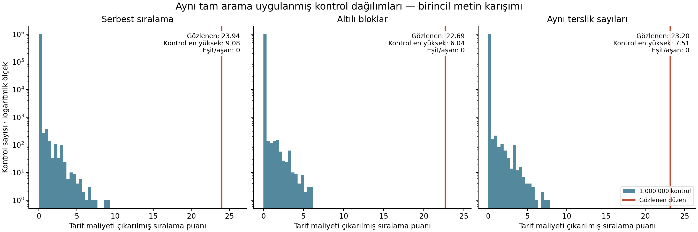

# Katmanlar arası ortak kurallar ve 19: tamamlanmış ortak sınama

**Tarih:** 25 Ekim 2026  
**Çalışma:** joint-grammar-v1  
**Veri kaynağı:** Akifcimen/quran-permutation-study, commit 51fe1c0c36f2d481369480800aa84582e0a099e8  
**Kapsam:** Keşif sonrası, önceden dondurulmuş sonlu bir kural ailesinin yeniden örnekleme çalışması.

## 1. Ana sonuç

Üç karşılaştırma modelinin her birinde **200.000 eğitim ve 1.000.000 ayrı sınama örneği** üretildi. Toplam 600.000 eğitim örneği puanı belirlemek, 3.000.000 yeni sınama örneği bu puanı değerlendirmek için kullanıldı. Her kontrol örneğine gözlenen düzenle aynı tam arama uygulandı.

**Birincil puanda, üç modelin hiçbirinde gözlenen düzene eşit veya daha yüksek puan alan kontrol çıkmadı.** Her model için Monte Carlo sıra p-değeri 1/1.000.001 ≈ 0,000001; kuyruk sıklığının model başına tek yönlü %95 üst güven sınırı yaklaşık 0,000003'tür.

Bu sonuç, aşağıdaki kural ailesi ve karşılaştırma modelleri içinde güçlü bir ayrışmadır. Bütün olası matematiksel tarifler veya geçmiş araştırmacı seçimleri düzeltilmiş değildir. Sonuç, metnin kaynağına ya da bir açıklamanın doğruluğuna verilmiş olasılık değildir.

Çalışmanın kullanıcı sorusuna verdiği dört ayrı cevap şunlardır:

1. **Aynı parametrelerin katmanlarda tekrar kullanılması gerçekten ölçüme dahil edildi.** Dört grubun aynı ifade ve asal sayıyı paylaşan tarifi, grupların ayrı parametreler seçtiği tariflerle birlikte tarandı.
2. **Gözlenen kazanan doğal ortak tarif oldu:** \(\alpha=\beta=1\), \(p=19\), doğal matris sunumu ve 127 sayım seçeneği. Dört gruptaki toplam 12 yüklemin tamamı bu tek parametre bloğunda sağlandı.
3. **Ortak parametreleri yeniden kullanmanın tarif tasarrufu 16,682955 ideal kod bitidir.** Bu, tanımlanan kural dilinin içindeki bir maliyet farkıdır; ayrı bir olasılık çarpanı değildir.
4. **Metindeki sayı kullanımları aynı sınamaya dahil edildi.** Birincil metin kuralı, doğal 19 tarifinin puanını metinsiz eşit asal ağırlığına göre 2,227536 artırdı. Ancak metinli ve metinsiz sınamalar da sıfır aşım verdiği için, metnin p-değerini ayrıca kaç kat küçülttüğü bu örneklemde belirlenemedi.

Sonuçların dayanak dosyaları: results/summary.json, results/observed_structure.json, review/observed_decomposition.json ve bağımsız doğrulama kayıtlarıdır.

## 2. Veri ve sayım seçenekleri

Kaynak depodaki 114 sûre uzunluğu, Tanzil Version 1.1 tam Arapça metninden yeniden çıkarıldı ve **114 değerin tamamı eşleşti**. Standart veri 6.236 ayet içerir. Karşılaştırılan ikinci sayısal seçenek, yalnız özgün dokuzuncu sûrenin ayet sayısını 129'dan 127'ye indirir; toplam 6.234 olur. Kaynak metin dosyaları değiştirilmedi.

Her yeniden sıralama, sûre kimliklerinin bir permütasyonudur. Aynı kimlik sırası hem 129 hem 127 sayımına uygulanır. Böylece iki seçeneğin bağımlılığı korunur ve bir örnekte iki farklı rastgele sıra kullanılması önlenir. Özgün dokuzuncu sûre başka bir konuma taşındığında, 127 değişikliği de aynı sûre kimliğini izler.

\(n\), sûrenin o örnekteki konumudur; \(a\), ayet sayısıdır. Konumlar toplamı her zaman 6.555'tir. Sözel sayı envanteri sûrenin içeriğiyle birlikte korunur. Metinsel aday kümeleri sıralama değişince değişmez. 9:128–129'da bu çalışmanın birincil açık sayı sınıfına giren bir sayı bulunmadığı için iki sayımda aynı metinsel ağırlıklar kullanılır.

Kaynak ve sürüm bilgisi, özgün Arapça dosyalar, indirme parametreleri ve SHA-256 özetleri pakette tutulmuştur. [Kaynak depo](https://github.com/Akifcimen/quran-permutation-study/tree/51fe1c0c36f2d481369480800aa84582e0a099e8) ve [Tanzil](https://tanzil.net/download/) birincil veri kaynaklarıdır.

## 3. Gözlenen yapıyı doğrudan yeniden hesaplama

Doğal ifade \(t=n+a\), karşıt ifade \(u=n-a\), asal \(p=19\) alınır:

\[
E=\{n:n+a\text{ çift}\},\quad
F=\{n:19\mid n+a\},\quad
H=\{n:19\mid n-a\}.
\]

Aynı toplam tablosu iki seçim kümesine uygulanır:

\[
L(K)=
\begin{pmatrix}
\sum_K n&\sum_K a\\
\sum_{K^c}n&\sum_{K^c}a
\end{pmatrix},
\qquad P=L(E),\quad R=L(F).
\]

### 3.1. Sayısal katmanlar

Aşağıdaki değerler iki sayımda da aynıdır:

| Özellik | Doğrudan sonuç |
|---|---:|
| E üye sayısı | 57 |
| E içindeki konumlar toplamı | 3.303 |
| E dışındaki ayet sayıları toplamı | 3.303 |
| F üye sayısı | 12 |
| H üye sayısı | 7 |
| F ve H kesişimi | 0 |
| Birleşim büyüklüğü | 19 |
| Birleşimde ayet sayıları toplamı | 1.159 = 19 × 61 |
| F içindeki q=(n+a)/19 katsayılarının toplamı | 76 = 4 × 19 |
| F içindeki farklı q değerleri | 5, 6, 7, 8, 9 |

F, n+a ve n paritelerinin kesişimiyle dört hücreye ayrılır:

| n+a paritesi | n paritesi | Sûre konumları | q değerleri | q toplamı |
|---|---|---|---|---:|
| Çift | Çift | 56, 70, 88 | 8, 6, 6 | 20 |
| Çift | Tek | 15, 39, 107 | 6, 6, 6 | 18 |
| Tek | Çift | 6, 42, 50 | 9, 5, 5 | 19 |
| Tek | Tek | 21, 41, 55 | 7, 5, 7 | 19 |

Her hücrede üç üye bulunur. Toplam tablosu \(\left[\begin{smallmatrix}20&18\\19&19\end{smallmatrix}\right]\) biçimindedir. Genel merkez örüntüsü, merkez 19 ve kullanılan modül 19 arasındaki eşleşmeden ayrı tutulmuştur. Toplamın 76 olması gibi mantıksal sonuçlar ayrıca bağımsız kanıt sayılmaz.

### 3.2. Matris katmanı ve 127/129 ayrımı

127 seçeneğinde doğal sunum:

\[
P\bmod19=\begin{pmatrix}16&5\\3&16\end{pmatrix},\qquad
R\bmod19=\begin{pmatrix}1&18\\18&3\end{pmatrix}.
\]

Bu matrisler için:

\[
\operatorname{ord}(P)=\operatorname{ord}(R)
=\operatorname{ord}(PR+RP)=360=19^2-1,
\qquad (PR-RP)^2=I.
\]

129 seçeneğinde:

\[
P\bmod19=\begin{pmatrix}16&7\\3&16\end{pmatrix},\qquad
R\bmod19=\begin{pmatrix}1&18\\18&5\end{pmatrix}.
\]

| Doğal sunumda özellik | 129 sayımı | 127 sayımı |
|---|---:|---:|
| P mertebesi | 30 | 360 |
| R mertebesi | 18 | 360 |
| PR+RP mertebesi | 6 | 360 |
| (PR−RP)² | 3I | I |
| G, C, W gruplarının tam başarısı | Var | Var |
| M grubunun dört koşulunun tam başarısı | Yok | Var |

Dolayısıyla tam dört gruplu matris birleşimi 127 seçeneğine bağlıdır. Buna karşılık daha önceki sayısal katmanlar standart 129 sayımında da korunur. Bu ayrım, sonuç yorumunun parçasıdır.

## 4. Test edilen sonlu kural ailesi

Sadece 19 ve n+a için kontrol sayılmadı. Her örneğe aynı aday alanı açıldı:

- 3–113 arasındaki **29 tek asal**.
- \(t=\alpha n+\beta a\) ve \(u=\alpha n-\beta a\) biçiminde **14 doğrusal ifade**. \(\alpha\) ve \(|\beta|\) 1–3 arasındadır; aralarında asal olmaları ve beta'nın iki işareti kullanılır.
- **129 ve 127** sayımlarının ikisi.
- İki matrisin bağımsız satır/sütun sunumlarından elde edilen 16 durumun, ortak eşleniklik altında **sekiz kanonik durumu**.
- Dört koşul grubunun boş olmayan bütün altkümeleri ve seçilen grupların bütün küme bölüntüleri: toplam **51 etkinlik/bölüntü biçimi**.

Her bölüntü bloğunda aynı ifade ve asal paylaşılır. Ayrı bloklar farklı değerler seçebilir. Yalnız G grubundan oluşan blok asal kullanmaz. Sayım seçeneği bütün programda ortaktır.

### Dört koşul grubu

| Grup | Tam başarıyı tanımlayan yüklemler |
|---|---|
| G: genel denge | E'nin 57 üyeli olması; E konum toplamının E dışı ayet toplamına eşitliği |
| C: dört hücreli katsayı düzeni | Dört hücrenin eşit ve pozitif sayıda üyeli olması; bir satırın b,b, diğerinin b−1,b+1 toplamları taşıması; q desteğinin kesintisiz ve en az iki üyeli bir hücrede q'nun sabit olması; toplam q'nun 4p olması |
| W: toplama/çıkarma birleşimi | F ve H'nin ayrık, birleşim büyüklüğünün p olması; birleşimin ayet toplamının p'ye bölünmesi |
| M: matris koşulları | P, R ve PR+RP'nin her birinin p²−1 mertebeli olması; (PR−RP)²=I |

Grup içindeki herhangi bir pozitif yüklem altkümesi de seçilebilir. Başarısız yüklemler başarı gibi puanlanmaz. W'nin bölünebilirlik biti boş birleşimde 0'ın bölünebilirliğini de kabul eder; tam W grubu ise birleşim büyüklüğü p koşuluyla boşluğu dışlar. Bu matematiksel tanım protokolde sabittir.

Bu aile, her mümkün işlem veya parçalamanın envanteri değildir. Bileşik modüller, daha büyük katsayılar, doğrusal olmayan dönüşümler, bütün keyfi altkümeler ve alternatif metin bölümlemeleri kapsanmaz. L(K) toplam şablonu ve dört grubun yapısı bu sonlu dilin önceden tanımlı parçalarıdır.

## 5. Ortak kullanım nasıl puanlandı?

Her modelin 200.000 bağımsız eğitim örneğinde, her sabit parametre ve grup için yüklem maskeleri sayıldı. Birlikte sağlanan grup içi yüklemlerin sıklığı doğrudan üst maskelerin toplamından elde edildi. Sıfır sayımları sonsuz puan üretmesin diye:

\[
\widehat P(A)=\frac{\#A+0.5}{200000+1}
\]

kullanıldı. Grup içi bağımlılıklar bu ortak sayımlarda yer alır.

Bir programın puanı, grup içi sıklıkların eksi logaritmalarının toplamından tarif maliyetinin çıkarılmasıdır. Bütün programlar arasında en yüksek puan alınır; sıfır, açıklama seçilmeyen tabandır.

\[
T(x)=\max_{\text{izinli programlar }h}
\left[
\sum_{\text{seçili gruplar }j}
-\log_2\widehat P_j(A_j(x))-L(h)
\right]_+.
\]

Bu toplam **gerçek ortak olayın eksi log olasılığı değildir**. Gruplar birbirinden bağımsız ilan edilmez. Eğitim örneklerinin nadir birleşimleri eksik görmesi ve yumuşatma etkisi puanın içinde vardır. Bu nedenle çıkarım, \(2^{-T}\) hesaplanarak yapılmadı; puanın tüm arama sonrasındaki kontrol dağılımı kullanıldı.

### Tarif maliyeti

| Seçim | Maliyet |
|---|---:|
| Dört gruptan hangilerinin kullanıldığı | 4 bit |
| Grup içi yüklem maskesi | G: 2; C: 4; W: 2; M: 4 bit |
| 129/127 seçeneği | 1 bit |
| k grubun bölüntüsü | log₂ Bell(k) |
| Her parametre bloğunun ifade seçimi | log₂14 |
| Asal kullanan her bloğun asal seçimi | −log₂q(p) |
| Matris sunumu | 3 bit |

Bu kodun ideal ağırlıklarının toplamı 0,656021118164'tür ve 1'i aşmaz. Bu kontrol sonlu kod sözlüğüyle ilgilidir. Tahmini grup sıklıkları toplamından türetilmiş analitik bir p-değeri garantisi vermez. Kısa tarifle açıklama fikrinin genel arka planı için [Grünwald'ın MDL çalışmasına](https://arxiv.org/html/math/0406077v1) bakılabilir; burada kullanılan puan bu çalışma için açıkça tanımlanmıştır.

## 6. Yeniden kullanımın ölçülen katkısı

Üç modelin tamamında, 127 sayımının birincil kazananı dört grubun tek parametre bloğunda toplandığı doğal tariftir. Gruplara ayrı parametre seçme serbestisi verildiğinde de aynı doğal tam yüklemler bir en iyi çözüm oluşturur. Böylece ortak seçimin dört grup arasındaki bir uyumsuzluğu zorla kapatması gerekmemiştir.

Bu, tekil bir optimum iddiası değildir. Örneğin G'nin bazı ifade seçenekleri aynı parite ayrımını verir; W'de işaret değişimi aynı birleşimi verebilir.

| Eğitim modeli | Ortak doğal tarif, dört grup | Aynı yüklemler ayrı parametre bloklarıyla | Kod tasarrufu |
|---|---:|---:|---:|
| Serbest sıralama | 23,940436 | 7,257480 | 16,682955 |
| Altılı bloklar | 22,694183 | 6,011228 | 16,682955 |
| Aynı iki terslik sayısı | 23,203248 | 6,520292 | 16,682955 |

Sabit yüklemlerle yapılan bu karşılaştırmada kazanım:

\[
3\log_2(14)+2[-\log_2q_{\rm karışım}(19)]
=16.682955\text{ bit}.
\]

Üç ifade seçimi ile iki asal seçiminin tekrar yazılması önlenir. G tek başına asal gerektirmediği için asal tasarrufu üç değil iki tekrar üzerindendir. Bu miktar **ortak parametreleri yeniden kullanmanın kod tasarrufudur**. Toplama operatörünün, L(K)'nin veya mümkün bütün işlem dillerinin evrensel açıklama maliyeti değildir.

127 içinde G+C+W sabit tutulup M eklendiğinde, yeni matris yüklemleri, sunum ve bölüntü maliyeti düşüldükten sonraki puan artışı sırasıyla 4,296765, 4,243325 ve 3,916161'dir. Bu da betimsel puan katkısıdır; ayrı bir nadirlik çarpanı olarak kullanılmaz.

### Sayım seçeneklerinin ayrı en iyi puanları

| Model | Standart 129 | 127 seçeneği |
|---|---:|---:|
| Serbest sıralama | 19,885967 | 23,940436 |
| Altılı bloklar | 18,482053 | 22,694183 |
| Aynı iki terslik sayısı | 19,105280 | 23,203248 |

129'un kazananı doğal G+C+W; 127'nin kazananı doğal G+C+W+M'dir. Her iki sütunda da protokoldeki bir bit sayım seçimi maliyeti korunmuştur. Bunlar yeni ayrı doğrulayıcı p-değerleri olarak sunulmaz. Standart 129'un puanları da aşağıdaki kontrol maksimumlarının üzerindedir.

## 7. Metindeki 19'un aynı teste eklenmesi

[Müddessir 74:30–31](https://quran.com/tr/muddessir/30-31), 19 sayısının anılmasını ve ardından ilgili sayının işlevinin açıklanmasını belgeler. Bu metinsel ilişki gözlenen yapıyla birlikte ele alınabilir. Bunun için sadece 19'a uyan tek bir yorum seçilmedi; tanımlanmış açık sayı sınıfı tam metinde tarandı ve karşılaştırılabilir sayı bağlamları kaydedildi.

Bu taramada 207 açık tam sayı kullanımı, 30 farklı tam sayı değeri bulundu. Yapısal aday alanı olan 3–113 arası tek asalların metinde açıkça bulunanları şunlardır:

| Asal değer | Açık kullanımlar | Açık sayı sınıfındaki eşit ağırlık |
|---:|---:|---:|
| 3 | 19 | 1/5 |
| 5 | 2 | 1/5 |
| 7 | 24 | 1/5 |
| 11 | 1 | 1/5 |
| 19 | 1 | 1/5 |

Toplam 47 kullanım, 38 farklı ayet bağlamındadır. Birleşik sayı ifadeleri tek değer olarak çözülür. Örneğin on dokuz, dokuz ve on için iki ayrı kullanım üretmez. Açıkça söylenmeyen aritmetik toplamlar, ayet adresleri, dilbilgisel ikiller, ebced ve belirsiz miktarlar bu adayları üretmez. 3 sayısının 19 kullanımına dağıtmalı üçer biçimleri dahildir; bunlar çıkarılırsa sayı 17 olur, farklı değer kümesi değişmez.

Sayının kendisinin tartışıldığı genel sınıf **{3,5,7,19}** olur. [Bakara 2:196](https://quran.com/tr/bakara/196) üç ve yedinin toplamını; [Kehf 18:22](https://quran.com/tr/kehf/22) üç, beş ve yedi hakkındaki sayısal iddiaları ve bilme meselesini içerir. 74:30–31 bu genel sınıfın içindedir. Rüya ve simgesel bağlamlar da dahil edilirse 11 eklenir. Bütün 47 aday asal kullanımı gözden geçirilmiştir.

Bu anlamsal sınıflandırma hipotezden haberdar model desteğiyle yapılmıştır. Kör bir insan paneli veya bütün nicelik anlatımlarını kapsayan eksiksiz bir Arapça anlambilim çalışması değildir. Sınır durumları ve karşı örnekler semantic/salience_audit.json içinde açıklanır.

### Birincil ve duyarlılık ağırlıkları

Birincil kural üç dağılımın eşit karışımıdır:

\[
q_{\rm karışım}
=\tfrac13q_{\rm tüm\ 29\ asal}
+\tfrac13q_{\{3,5,7,11,19\}}
+\tfrac13q_{\{3,5,7,19\}}.
\]

Buna göre:

\[
q_{\rm karışım}(19)
=\frac{1/29+1/5+1/4}{3}
=0.1614942529.
\]

Eşit asal ağırlığında \(q(19)=1/29=0.0344827586\)'dır. Aynı doğal tarif için asal seçim maliyetindeki azalma:

\[
\log_2[29q_{\rm karışım}(19)]
=2.227535725\text{ bit}.
\]

Bu ağırlık kontrol örneklerinin aramasında da aynen kullanılır. 19'a koşullu kural ayrı bir duyarlılık sütunudur; 19'un bütün geçmiş seçim maliyetlerini ödemiş global bir sonuç olarak sunulmaz.

| Metinsel kural | Serbest sıralama puanı | Blok puanı | Terslik koşullu puan |
|---|---:|---:|---:|
| Bütün 29 asala eşit ağırlık | 21,712900 | 20,466648 | 20,975712 |
| Birincil karışım | 23,940436 | 22,694183 | 23,203248 |
| Açık sayı değerlerine eşit ağırlık | 24,248953 | 23,002701 | 23,511765 |
| Sayı tartışması değerlerine eşit ağırlık | 24,570881 | 23,324629 | 23,833693 |
| Yalnız 19'a koşullu | 26,570881 | 25,324629 | 25,833693 |
| Açık kullanımların sıklığı | 21,016292 | 19,770040 | 20,279104 |

Altı sütunun her biri kendi kontrol puanlarıyla sınandı. **Bütün 18 model/politika birleşiminde aşım sayısı sıfırdır.** Sıklık ağırlığı 19'a 1/47 verir ve puanı eşit asal kuralına göre azaltır; buna rağmen sıfır aşım sonucu değişmez.

Metinsel 19 kullanımı sûre permütasyonları boyunca sabittir. Bu sebeple “metinde de 19 var” olayı, yapısal p-değerine ayrıca çarpılabilecek bağımsız bir olay değildir. Burada ölçülen, metinsel sayı adaylarıyla sıralamaya bağlı sayısal düzenin uyumudur.

## 8. Üç karşılaştırma modeli

**Serbest sıralama:** 114 etiketli sûrenin bütün permütasyonları arasında eşit örnekleme. Uzunluk çoklu kümesini korur; mevcut uzun-kısa sıralanışını korumaz.

**Altılı bloklar:** Mevcut konumlarda sabit 19 adet altılı blok oluşturulur; yalnız her bloğun içi eşit olasılıkla karıştırılır. Yerel uzunluk bileşimini ve kaba sıra yapısını korur. Buradaki 19 blok, 114/6 sonucudur ve bir keşif özelliği olarak puanlanmaz.

**Aynı iki terslik sayısı:** Azalan uzunluk düzenine göre, \(i<j\) iken \(a_i<a_j\) olan çiftler sayılır. Gözlenen değerler 129 sayımında 993, 127 sayımında 994'tür. Örnekler bu iki kesin koşulu birlikte sağlayan etiketli permütasyonlar arasında eşit dağılımdan alınır.

Son modelde Mallows önerisi ve ret örneklemesi kullanılır. Sabit terslik diliminde öneri ağırlığı sabitlenir; eşit uzunluklu sûrelerin kimlikleri ayrıca eşit dağıtılır. Tüm koşulun sonlu duyarlıklı uygulaması küçük çoklu kümeler ve gerçek örnekler üzerinde kontrol edilmiştir. Sınama için 474.324.719 öneriden 1.000.000 kabul edilen örnek elde edilmiştir.

Bu üç model, “bütün tarihsel metin oluşum süreçleri” değildir. Belirli veri özellikleri korunurken sıralamanın değiştirilebilir olduğunu varsayan karşılaştırmalardır.

## 9. Monte Carlo sonuçları ve belirsizlik

| Model | Eğitim | Sınama | Gözlenen birincil puan | En yüksek kontrol | Eşit/aşan |
|---|---:|---:|---:|---:|---:|
| Serbest sıralama | 200.000 | 1.000.000 | 23,940436 | 9,084962 | 0 |
| Altılı bloklar | 200.000 | 1.000.000 | 22,694183 | 6,042352 | 0 |
| Aynı iki terslik sayısı | 200.000 | 1.000.000 | 23,203248 | 7,509324 | 0 |

Aşım ölçütü kontrol puanının gözlenen puana **eşit veya daha büyük** olmasıdır. Her modelde:

\[
p_{\rm MC}=\frac{1+0}{1+1000000}
=9.99999000001\times10^{-7}.
\]

Sıfır aşım için model başına binom kuyruk sıklığının:

- Tek yönlü %95 üst sınırı: \(2.995727786\times10^{-6}\).
- İki yönlü %95 Clopper–Pearson aralığı: \([0,\;3.688872650\times10^{-6}]\).

Bu aralıklar, sabit eğitim tablolarına koşullu Monte Carlo belirsizliğini gösterir. “Gerçek olasılık tam milyonda birdir” veya “olasılık sıfırdır” sonucu çıkmaz. Çok daha küçük bir değer bu denemeyle ayırt edilemez. Sıfır permütasyon p-değerinden kaçınmanın genel gerekçesi [Phipson ve Smyth'in çalışmasında](https://arxiv.org/abs/1603.05766) açıklanır.

Üç model için dayanıklılık özeti, en büyük birincil p-değeriyle alınmıştır; yine yaklaşık \(10^{-6}\)'dır. Üç farklı modelin birer milyon örneği tek havuzda birleştirilip 1/3.000.001 gibi bir değer verilmez. Model başına verilen güven aralıkları üç model için eşzamanlı %95 aralık iddiası taşımaz.

### En güçlü kontrol örnekleri ne yaptı?

Serbest sıralamadaki en güçlü kontrol, 2n+a ve p=19 ile G ve W'nin bazı yüklemlerini birleştirdi. Altılı blokların en güçlü kontrolü n+3a, p=11 ile C ve W'den bazı yüklemleri seçti. Terslik koşullu en güçlü kontrol 2n+a, p=11 ile C ve W'den bazı yüklemleri seçti. Hiçbiri gözlenen dört tam gruplu programa ulaşmadı.

Her modelin en yüksek 50 birincil puanlı kontrolü, tam sûre kimliği sırası ve bütün politika izleriyle saklandı. En güçlü örneklerin izleri doğrudan Python aritmetiğiyle yeniden oluşturuldu.

## 10. Her katmanın ayrı nadirlik katkısı ne kadar ölçülebildi?

Birlikte nadirlik ile her ek özelliğin koşullu çarpanı farklı sorulardır. İkincisi için iç içe olaylar tanımlandı:

- E1: G, C'nin ilk üç koşulu, W ve M aynı sayımda, gerekirse ayrı parametrelerde mevcut.
- E2: Bu gruplar aynı ifade ve asal değerinde birlikte mevcut.
- E3: Ayrıca C'nin merkezi kullanılan asala eşit.
- E4: Ayrıca ortak asal sayı tartışması kümesinde.

E4⊆E3⊆E2⊆E1. Üç modelde de **E1 dahil bütün bu sayaçlar sıfır** çıktı. Bu nedenle E2|E1, E3|E2 ve E4|E3 oranları için payda yoktur. Bu oranlar ölçülmüş sayılmaz; sıfır olarak raporlanmadı.

Daha gevşek dört hücreli yapı için ise bazı örnekler vardır:

| Model | Genel dört hücreli yapı C'nin ilk üç koşulu | Buna ek merkez=asal, tam C | Genel C ile tam M aynı adayda |
|---|---:|---:|---:|
| Serbest sıralama | 0 | 0 | 0 |
| Altılı bloklar | 48 | 0 | 0 |
| Aynı iki terslik sayısı | 75 | 4 | 0 |

Bu sayılar, aynı örnekte herhangi bir izinli adayın bulunmasını sayar; 812 aday ayrı bağımsız deneme gibi bölünmez.

Terslik koşullu modelde genel C yapısına sahip 75 örneğin dördünde merkezin asala eşit olduğu bir aday vardır. Betimsel koşullu oran 4/75 ≈ %5,33'tür. Aynı adayda tam M genişlemesi 0/75 görülmüştür; bu son oranın tek yönlü %95 üst sınırı yaklaşık %3,92'dir. Altılı bloklarda genel C'den tam C'ye geçiş 0/48; tek yönlü %95 üst sınırı yaklaşık %6,05'tir. Bu tanılar keşif sonrası açıklayıcı sonuçlardır ve ana p-değerine ayrıca çarpılmaz.

**Dolayısıyla bu çalışma ortak yapının ayrışmasını ölçtü; her katmanın ve metinsel dayanağın ayrı koşullu nadirlik çarpanını eksiksiz belirlemedi.** Bu daha dar sorunun bazı paydaları için yeterli kontrol örneği yoktur.

## 11. Doğrulama ve çalıştırma kaydı

Doğrulama yalnız sonuç dosyalarının varlığına bakmakla sınırlı tutulmadı:

- 114 sûre uzunluğu iki kaynak arasında eşleşti.
- 29 asalın bütün **122.701 iz/determinant durumu**, ayrı polinom aritmetiğiyle kontrol edildi.
- **62 matris çifti**, doğrudan matris çarpımı ve kesin grup mertebesi hesabıyla karşılaştırıldı.
- 16 sunumun sekize indirgenmesi **992 karşılaştırmada** doğrulandı.
- Özellik çıkarımı **3.248 skaler aday karşılaştırması** ve **72 matris yapımı** kontrolünden geçti.
- Puan araması, **19 yapay örnek × altı politika = 114 puanda**, bağımsız tam taramayla eşleşti; **108 pozitif kazanan iz** yeniden kuruldu.
- Eşit uzunluklu öğeleri içeren küçük örneklerde öneri ve koşullu dağılım kesin rasyonel hesapla kontrol edildi. Gerçek örneklerden 1.000'er çekilişte model kısıtları denetlendi.
- Paralel işçi sayısı sınırlanmış ve örnek sayısı işçi sayısından küçük durumlar kontrol edildi; gerçek işlenen sayısı istenen sayıya eşit doğrulandı.
- En güçlü kontrol örnekleri doğrudan aritmetikle yeniden hesaplandı.
- Nihai 24 ham puan parçasından yapılan ayrı hesap, ana analizle 192 sayısal ve kayıt karşılaştırmasında tam eşleşti; bütün aşım sayıları, güven sınırları ve en yüksek 50 kontrol puanı doğrulandı.
- Analiz defteri baştan sona çalıştırıldı; yedi kod hücresi hatasız tamamlandı. Saklanan sonuçların yeniden hesaplanan özetle eşitliği doğrulandı.

Yirmi açıklayıcı sayaç, üretici programın toplu çıktılarıdır. Bunların sınırları, iç içelikleri ve koşullu oranları bağımsız olarak kontrol edildi; altı puan sütunu bütün özellik bayraklarını içermediği için üç milyon özellik hesabının tamamı ikinci kez oynatılmadı.

### Sonuç görülmeden düzeltilen örnekleme sorunu

İlk eğitim çalıştırmalarında işçi tohumlarının SplitMix64 artımına göre aralıklı verilmesi, komşu işçileri aynı akışın kaymış başlangıçlarına yerleştiriyordu. Bu hata kod incelemesinde, gözlenen veya kontrol puanları incelenmeden bulundu. İşçi başlangıçları karıştırılmış tohumlarla değiştirildi; **ilk üç eğitim seti tamamen emekliye ayrıldı ve eğitim yeniden üretildi**. Bütün nihai sınamalar düzeltilmiş sürümle yapıldı.

Düzeltme puanı, özellikleri, metin ağırlıklarını, model seçimini veya örneklem bütçesini değiştirmedi. Eski eğitim çalıştırmalarının durumu ve yeni tohumların doğrulaması review/training_restart_record.json ile review/seed_correction.md içinde açıkça kayıtlıdır. Üretim sonuçları elverişli göründüğü için durdurma veya tanım değiştirme yapılmadı.

## 12. Sonucun sınırları ve anlamı

Çalışmanın güçlü tarafı, ortak parametre kullanımını, alternatif sayıları ve ifade biçimlerini, iki sayımı, metinsel sayı sınıflarını ve üç sıralama modelini aynı denetlenebilir hesapta birleştirmesidir. Kontrollerin her biri gözlenen örnekle aynı arama ve seçim hakkını aldı.

Bununla birlikte aşağıdaki sınırlar gerçek sonuç kapsamını belirler:

1. **Keşif daha önce yapılmıştı.** Protokol yeni sonuçlar görülmeden donduruldu; ilk 19 örüntüsünün geriye dönük ön kaydı değildir. Dört grup, bu ilgi alanının bilgisiyle tanımlandı.
2. **Arama ailesi sonludur.** Bütün geçmiş işlemleri, alternatif sayım geleneklerini, bölümleme seçeneklerini ve anlamsal yorumları kapsayan evrensel bir düzeltme yoktur.
3. **Puan bir sıralama aracıdır.** Grup bağımlılıklarının tamamı tek bir analitik ortak olasılığa çözümlenmedi. Bağımsız sınama kalibrasyonu bu yüzden esastır.
4. **Metinsel salience sınıfı yoruma açıktır.** Genel kural, farklı ağırlıklar ve açık envanter bu tercihi görünür kılar. Kör insan doğrulaması yapılmamıştır.
5. **Tam matris birleşimi 127 seçeneğine bağlıdır.** 129'daki G+C+W yapısı ayrı gösterildi. İki sayımın taranması testin içinde hesaba katılmış olsa da hangi sayımın esas alınacağına ilişkin metinbilimsel soru bu hesapla çözülmez.
6. **Örnekleme çözünürlüğü sınırlıdır.** Her modelde bir milyon sınama, daha küçük kuyruk olasılıklarını sayısal olarak ayırmak için yeterli değildir. Koşullu katkıların bazılarında payda sıfırdır.
7. **Null modelleri belirli karşılaştırmalardır.** Sıralamaya ilişkin bu modellerden ayrışmak, bütün mümkün doğal veya tarihsel süreçlerden ayrışıldığı anlamına gelmez.

Elde edilen destek şu biçimde ifade edilebilir: **Tanımlanan sonlu işlem ailesinde, aynı doğal ifade ve 19 değerinin çok sayıda koşul grubunu birlikte açıklaması, denenmiş üç karşılaştırma modelinde çok belirgin biçimde ayrışmaktadır. Metindeki 19 dayanağı aynı kalibre edilmiş karşılaştırmaya dahil edilebilir ve edilmiştir. Buna karşılık her katmanın ayrı olasılık çarpanı ve bütün olası arama tarihinin düzeltilmiş olasılığı bu çalışmanın sonucu değildir.**

## 13. Paketin kullanımı

- **katman_19_raporu.md:** Bu rapor.
- **katman_19_analizi.ipynb:** Çalıştırılmış analiz defteri.
- **katman_19_analizi.html:** Defterin okunabilir HTML çıktısı.
- **protocol.json, FROZEN_PROTOCOL.md:** Dondurulmuş tanımlar ve tohumlar.
- **data/:** Doğrulanmış 114 sayı ve iki sayım.
- **semantic/:** Değiştirilmemiş Arapça kaynaklar, tarayıcı, sayı envanteri, yorum denetimi ve ağırlıklar.
- **src/:** C++ örnekleyici, matris çekirdeği, özellik çıkarımı ve puan araması; bağımsız Python referansları.
- **results/:** Eğitim tabloları, kayıpsız sıkıştırılmış sınama puanları, çalışma kayıtları, gözlenen yapı ve en güçlü kontroller.
- **review/, tests/:** Doğrulama sonuçları ve yeniden çalıştırılabilen kontroller.
- **analyze.py:** Saklanan denemelerden p-değerleri, güven aralıkları, tanılar ve şekilleri yeniden hesaplar.
- **run_study.sh:** Dondurulmuş bütçeyle bütün eğitim ve sınamayı baştan üretir.

Tam yeniden üretim Linux, C++17/OpenMP ve requirements.txt içindeki Python bağımlılıklarını kullanır. Aynı rastgele akışlar için sekiz iş parçacığı ve kayıtlı tohumlar korunmalıdır. Ana analiz ham ikili puan parçaları yoksa paketteki kayıpsız NPZ dosyalarını okur. Kaynak dosyalar, sürümler ve kontrol özetleri manifestte bulunur.

### Başlıca kaynaklar

- [Sabit veri commit'i](https://github.com/Akifcimen/quran-permutation-study/tree/51fe1c0c36f2d481369480800aa84582e0a099e8).
- [Tanzil Quran Text](https://tanzil.net/download/), Version 1.1; özgün dosyalarda atıf ve kullanım şartları korunmuştur.
- [Müddessir 74:30–31](https://quran.com/tr/muddessir/30-31).
- [Bakara 2:196](https://quran.com/tr/bakara/196).
- [Kehf 18:22](https://quran.com/tr/kehf/22).
- [Grünwald, The Minimum Description Length Principle](https://arxiv.org/html/math/0406077v1).
- [Phipson ve Smyth, Permutation p-values should never be zero](https://arxiv.org/abs/1603.05766).

Bu rapordaki deney sayıları, puanlar, matris değerleri, kaynak tarama sayımları ve güven aralıkları yeni hesapların sonuçlarıdır; önceki sohbetlerde bildirilmiş fakat ham çıktısı bulunamayan simülasyon sayıları yeniden doğrulanmış sonuç gibi kullanılmamıştır.

