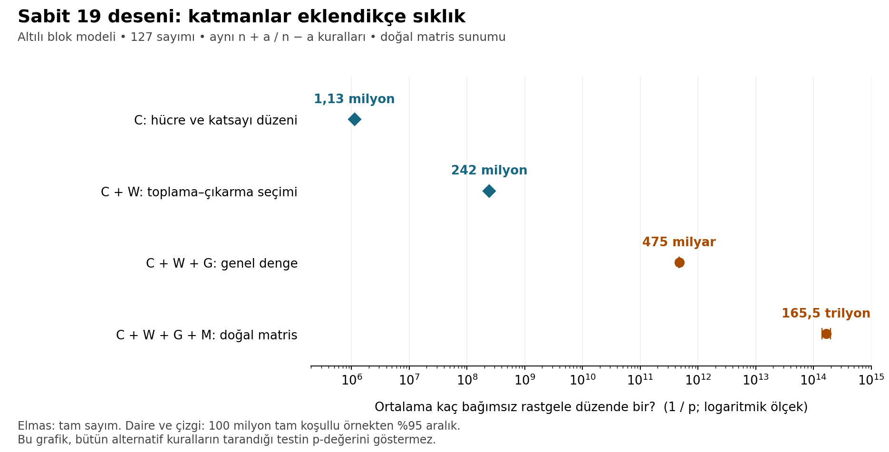
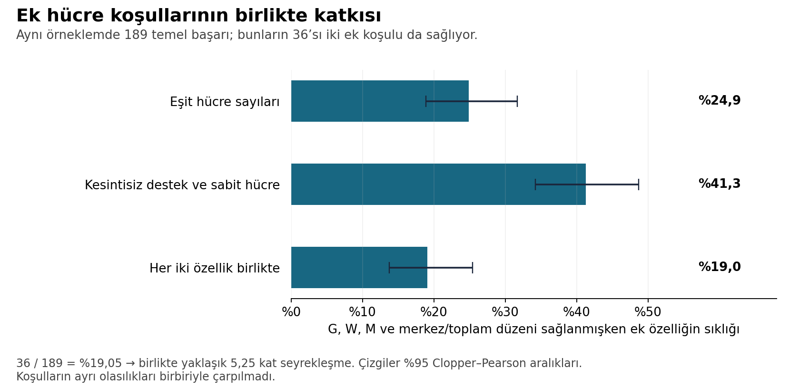

# Katmanlar arası ortak 19 deseni: nadirlik hesabının genişletilmesi

**26 Ekim 2026 — önceki dondurulmuş sınamaya ek çalışma**

## 1. Doğrudan cevap ve kapsam

**Sabit doğal desen için artık bir sıklık tahminimiz var:** Altılı bloklar içinde rastgele sıralama modelinde, 127 sayımı ve doğal matris sunumuyla dört grubun bütün koşullarının birlikte sağlanma olasılığı yaklaşık **6,0421 × 10⁻¹⁵**, yani ortalama **165,5 trilyon bağımsız düzende bir**.

%95 güven aralığı olasılık olarak **[5,1018 × 10⁻¹⁵; 7,1055 × 10⁻¹⁵]**; ters çevrildiğinde ortalama tekrar sayısı için **140,7–196,0 trilyon**. Bu aralık, belirtilen model ve sabit desen içindeki örnekleme belirsizliğini ölçer. Model seçimini veya geçmişte denenmiş bütün tarifleri kapsamaz.

**Aynı sabit desenin serbest karıştırma modelindeki hesabı da tamamlandı:** Olasılık yaklaşık **7,7807 × 10⁻¹⁸**, beklenen tekrar sayısı **128,5 katrilyon**. Ağırlıklı bağımsız örnekleme hesabından yaklaşık %95 aralık, olasılık için **[5,8546; 9,7068] × 10⁻¹⁸**, beklenen tekrar sayısı için **103,0–170,8 katrilyon**. Bu ikinci aralık yaklaşık bir Monte Carlo aralığıdır; altılı blok hesabındaki tam kapsama güvencesi olan binom aralığıyla aynı tür değildir.

Bu sayı ile **bütün alternatif asal, işlem, sayım, matris sunumu ve katman bölüntülerinin tarandığı testin kuyruk olasılığı** farklıdır. Geniş test için ayrıca hesap yaptık; onun sonuç ve doğrulama durumu aşağıda ayrı gösteriliyor. Sabit desen sonucunu arama sonrası p-değeri olarak kullanmıyoruz.

**Geniş testin tüm kuyruğu için güvenilir bir nokta tahmini henüz elde edilemedi.** Önceden belirlenen hassasiyet kapılarını geçmeyen modeller: Tam karıştırma, Altılı blok, Tam terslik koşulu. Aşağıdaki SMC ortalamaları keşifsel tanılardır; bunların tersi kesin nadirlik diye raporlanmaz.

**Bağımsız ek sonuç:** Altılı blok geniş testinin yalnız 7 koşullarıyla kesişen bölümünde başarı yaklaşık 503 milyarda bir. Bu bileşen ve önceki doğrudan sınama, tam kuyruğun beklenen tekrar sayısını %95 güvenle yaklaşık **271 bin–524 milyar** arasında sınırlar.

## 2. Neyin nadirliğini ölçtük?

Veri, 114 sûre kimliğine bağlı ayet sayılarıdır. Standart 129 sayımı ile yalnız özgün dokuzuncu sûrenin sayısını 127 yapan seçenek aynı kimlik permütasyonunda değerlendirilir. Gözlenen tam doğal matris deseni 127 seçeneğine bağlıdır; standart 129 seçeneğinde gözlenen doğal matrisler bu dört koşulu sağlamaz.

Sabit desenin ortak parametreleri:

\[
t=n+a,\qquad u=n-a,\qquad p=19,
\]

\[
E=\{n:n+a\text{ çift}\},\quad F=\{n:19\mid n+a\},\quad H=\{n:19\mid n-a\}.
\]

| Grup | Sınanan yapı |
|---|---|
| G — genel denge | E'nin 57 üyeli olması; E'deki konum toplamının E dışındaki ayet toplamına eşitliği |
| C — hücre ve katsayı düzeni | Dört hücrede eşit ve pozitif üye sayıları; merkez çevresinde iki eşit ve iki komşu toplam; kesintisiz katsayı desteği ve en az iki üyeli sabit bir hücre; katsayı toplamının 4p olması |
| W — toplama ve çıkarma seçimi | F ve H'nin ayrık olması, birleşimin p üyeli olması, birleşimde ayet toplamının p'ye bölünmesi |
| M — doğal matris düzeni | Aynı toplam tablosunun E ve F'ye uygulanmasıyla elde edilen P, R ve PR+RP'nin mod p mertebelerinin p²−1 olması; (PR−RP)²=I |

Toplam **12 pozitif koşul** vardır. Birbirinden mantıksal olarak türeyen eşitlikleri bağımsız kanıt gibi yeniden çarpmadık. C, özgün katsayı listesinin her rakamını ayrı ayrı zorunlu tutmaz; önceki çalışmada tanımlanmış yapısal koşulları korur. Altılı blok modeli içinde bu tam C koşullarına uyan iki katsayı düzeni vardır ve ikisi de sayılmıştır.

## 3. Karşılaştırma modeli

Bu bölümdeki 165,5 trilyon sonucu, **19 ayrı altılı konum bloğunun kendi içinde bağımsız ve eşit olasılıkla karıştırıldığı** modele aittir. Etiketli örnek uzayı 720¹⁹ düzendir. Yakındaki sûrelerin büyüklük yapısı büyük ölçüde korunur. Bu, bütün 114 sûrenin serbestçe karıştırıldığı modelle aynı değildir.

Ek çalışmada üç özgün model de korundu: serbest permütasyon, altılı bloklar ve iki sayımda tam olarak I₁₂₉=993 / I₁₂₇=994 koşulunu sağlayan permütasyonlar. Farklı modellerin sonuçları tek bir ortalamada birleştirilmedi.

| Sabit doğal 19 deseni için model | Beklenen tekrar tahmini | %95 aralık türü ve sınırları |
|---|---:|---|
| Bütün 114 kimliği serbest karıştırma | 128,5 katrilyon | Yaklaşık ağırlıklı Monte Carlo: 103,0–170,8 katrilyon |
| On dokuz altılı bloğun her birini kendi içinde karıştırma | 165,5 trilyon | Tam koşullu binom: 140,7–196,0 trilyon |
| Her iki sayımın terslik sayısını tam koruma | Güvenilir nokta tahmini elde edilemedi | Sabit doğal olay için ayrı bir hassas aralık raporlanmıyor |

Serbest karıştırma aynı ayet sayılarını korurken bütün konumları değiştirebilir. Altılı blok modeli yerel konum kısıtları koyar. İki nokta tahmini arasındaki yaklaşık 777 kat fark, aynı özelliğin nadirliğinin karşılaştırma uzayına duyarlı olduğunu gösterir. Modeller arasındaki bu farkı örnekleme hatası gibi birleştirmedik.

“Ortalama 165,5 trilyonda bir”, aynı modelden bağımsız denemelerde sabit olayın ilk görülmesine kadar beklenen deneme sayısının 1/p olması anlamına gelir. Bu, metinlerin tümü için evrensel bir sıklık veya bir açıklamanın doğru olma olasılığı değildir.

## 4. Katmanlar eklendikçe bulunan sıklık

| Zorunlu koşullar | Olasılık | Ortalama tekrar sıklığı | Hesap |
|---|---:|---:|---|
| C | 8,8457495204 × 10⁻⁷ | 1,13 milyonda bir | Tam sayım |
| C + W | 4,1384256856 × 10⁻⁹ | 242 milyonda bir | Tam sayım |
| C + W + G, 127 | 2,1059620629 × 10⁻¹² | 475 milyarda bir | Tam koşullu örnekleme |
| C + W + G + M, 127/doğal sunum | 6,0421015010 × 10⁻¹⁵ | 165,5 trilyonda bir | Tam koşullu örnekleme |

İlk iki olasılığın sadeleştirilmiş tam kesirleri:

\[
P(C)=\frac{12997308130651}{14693280768000000000},
\]

\[
P(C\cap W)=\frac{6052295999638228458971}{1462463376025190400000000000000}.
\]

C∩W'yi sağlayan düzenler arasından **100.000.000 bağımsız ve eşit olasılıklı** örnek üretildi. Bunların **50.888'i** G'nin 127 koşullarını, **146'sı** G ile doğal M koşullarını birlikte sağladı. Böylece

\[
\widehat P(C\cap W\cap G_{127}\cap M_0)
=P(C\cap W)\frac{146}{100000000}.
\]

Güven aralığı, 146/100.000.000 oranının iki yönlü Clopper–Pearson aralığının tam bilinen P(C∩W) ile çarpılmasıdır. Tek tek katmanların güven aralıkları çarpılmadı.

Koşullu katkılar da ölçülebilir:

| Önceki koşullar verilmişken ek koşul | Koşullu olasılık | Bu sıradaki seyrekleşme |
|---|---:|---:|
| C verilmişken W | 0,00467843 | Yaklaşık 214 kat |
| C∩W verilmişken G₁₂₇ | 0,00050888 | Yaklaşık 1.965 kat |
| C∩W∩G₁₂₇ verilmişken M₀ | 0,00286905 | Yaklaşık 349 kat |

Bu çarpanlar **koşullu olasılık zinciridir**. Sıralama değiştirilirse tek tek katkılar da değişebilir; ortak olasılık değişmez. G, C, W ve M'nin bağımsız olduğu varsayılmamıştır.

### 4.1. Serbest karıştırmada sabit desen

Serbest permütasyon için ayrı bir örnekleyici kuruldu. Tam C∩W₁₂₇ yapısına gidebilen **985.178.375.935.386.285 etiketli F kısmi eşleşmesi**, 20 mümkün katsayı düzeni üzerinden tam sayıldı. F seçimi tam tamsayı örneklemesiyle, kalan H ve diğer eşleşmeler olasılıkları kaydedilerek üretildi. Her tamamlanmış düzenin yedi H üyesinin 7! üretim sırası olduğu hesaba katıldı.

Bu yöntem hedef olaya yoğunlaşırken olasılıkları doğru ağırlıklarla geri taşır. Sabit **100.000.000** önerinin tümü, tamamlanamayan öneriler sıfır katkıyla birlikte paydada tutuldu. Olay tahmini **ağırlıklı katkıların toplamı / 100.000.000** şeklindedir. Katkılar eşit ağırlıklı olmadığı için ham başarı oranına binom aralığı uygulanmadı.

| Koşullar, serbest model | Olasılık tahmini | Beklenen tekrar tahmini |
|---|---:|---:|
| C∩W₁₂₇ | 9,3677135905 × 10⁻¹² | 106,75 milyar |
| C∩W₁₂₇∩G₁₂₇ | 3,2256276077 × 10⁻¹⁵ | 310,02 trilyon |
| C∩W₁₂₇∩G₁₂₇∩M₀ | 7,7807161113 × 10⁻¹⁸ | 128,52 katrilyon |

Son olay için **83 pozitif katkı** bulundu. Etkin katkı sayısı yaklaşık **62,69**, göreli standart hata **%12,63** ve tek örneğin toplam içindeki en büyük payı **%3,46**. Önceden belirlenen dört hassasiyet koşulu da geçti. İki 50 milyonluk partide 40 ve 43 başarı; 16 işçi grubunun tamamında pozitif katkı vardı. Partilerin tahminleri arasındaki fark yaklaşık 0,99 standart hata çıktı.

Ana yaklaşık %95 aralık ağırlıklı örneklerin birinci ve ikinci momentlerinden hesaplandı. 16 bağımsız grubun t aralığı **[5,9154; 9,6460] × 10⁻¹⁸** ile aynı sonucu destekledi. Her iki aralık da yaklaşık Monte Carlo aralığıdır; bütün seçilmemiş hipotezleri veya model yanlılığını kapsamaz. Önceden belirlenen tanıların geçmesi, her türlü sonlu örneklem riskinin ortadan kalktığı anlamına gelmez.

Bu örneklemde C∩W verilmişken G yaklaşık 2.904'te bir; C∩W∩G verilmişken doğal M yaklaşık 415'te bir görüldü. İç içe olayların kovaryansı belirsizlik hesabında korundu. Ayrıca bu C∩W ve doğal G kesişimi içinde altı tam puan politikasının her birinde aynı 83 katkı görüldü. Bu sayısal eşitlik, sınırlı bileşenin tam geniş kuyruğa eşit olduğunu göstermez.

## 5. Yapısal ayrıntılar ne kadar katkı sağlıyor?

İkinci, bağımsız deneyde C'nin yalnız merkez/toplam düzeni ile W tam olarak koşullandı. Bu daha geniş koşulun olasılığı tam sayımla **1,7731145864 × 10⁻⁸** bulundu. Bu koşuldan ayrı **100.000.000** örnek çekildi.

Bu örneklerde G₁₂₇ ve doğal M₀'ı da sağlayan **189** düzen vardı. Bunların:

- **47'si** eşit hücre üye sayılarını sağladı.
- **78'i** kesintisiz katsayı desteği ve sabit hücre koşulunu sağladı.
- **36'sı** iki ek koşulu birlikte sağladı.

Dolayısıyla iki ek hücre özelliğinin birleşik katkısı, aynı örneklemde **36/189 = %19,05**; %95 aralık **%13,71–%25,38**. Karşılıklı bağımlılık korunarak bulunan seyrekleşme yaklaşık **5,25 kat**; ters aralık yaklaşık **3,94–7,29 kat**.

Daha gevşek G–W–M ve merkez/toplam deseni yaklaşık **29,84 trilyonda bir** görülüyor. Tam C koşulları eklendiğinde ilk bağımsız deneyin tahmini **165,5 trilyonda bir**. İkinci deneydeki 36 tam başarı ilk deneyle uyumludur; deneyler sonuca göre seçilerek veya başarılı örnekler ayıklanarak birleştirilmedi.

## 6. Neden bunu geniş testin p-değeri saymıyoruz?

Özgün geniş test **29 asal, 14 doğrusal ifade, iki sayım, sekiz kanonik matris sunumu ve 51 katman etkinliği/bölüntüsü biçimini** tarar. Katmanlar aynı parametreleri paylaşabildiği gibi ayrı bloklarda farklı parametreler de seçebilir. Her kontrol örneğine aynı arama uygulanır.

Bu testin hedefi, bütün 12 koşulun aynısını tekrar etmek değil, **dondurulmuş ortak arama puanının gözlenen puana eşit veya yüksek olmasıdır**. Puan, eğitim frekansları ve tarif maliyetleriyle kurulan bir sıralama ölçüsüdür; 2⁻ᵀ bir olasılık değildir.

Somut karşı örnekler bunu gösterdi. Bazı düzenler C'nin bütün koşullarını sağlamadan aynı gözlenen puana ulaşabiliyor. Yeni nadir olay örneklerinde ise **7 sayısı**, farklı doğrusal ifadeler ve daha az koşullu G+C+W tarifleri gözlenen puanı aşabildi. Bu nedenle yalnız doğal C∩W veya C'nin tam koşullarına sınırlı örnekleme, geniş testin bütün kuyruğunu sayamaz.

200.000 eğitim örneğinde hiç görülmeyen farklı birleşimlerin aynı yumuşatma tabanına gelmesi de puanda bazı eşitlikler yaratır. Hesabın hedefi bu dondurulmuş puandır; yeni sonuçlara bakarak puan veya eşik değiştirilmedi.

## 7. Geniş kuyruk için yeni hesap

Önceki doğrudan sınamada her model için 1.000.000 bağımsız kontrol vardı ve hiçbir aşım yoktu. Model başına tek yönlü %95 üst sınır **2,9957277864 × 10⁻⁶** idi. Bu, gerçek sıklığın nokta tahmini değildir.

Bu ek çalışmada, puanı değiştirmeden nadir bölgelere örnek taşıyan sıralı Monte Carlo yöntemi kuruldu. Yumuşak yardımcı puan Sλ, asıl puanı üstten sınırlar; λ arttıkça asıl puana eşit olur. Yardımcı yoğunluk exp[−β max(0,Tgözlenen−Sλ)] ile ağırlıklandırılır. Her aşamada bilinen ağırlık oranı kullanılır ve son aşamada asıl dondurulmuş puan yeniden değerlendirilir.

İlk pilotlar yöntemi ve örnek bütçesini seçmek için kullanıldı. Sonraki sabit plan her model için **512 parçacık, aşama başına 128 teklif ve sekiz bağımsız tekrar** içerir. Başlangıçlar özgün sıfır modelinden çekilir. Sıfır başarı veren tekrarlar da ortalamada tutulur. Başarılı tekrarları seçerek ortalama almak yasaktır.

Aşağıdaki değerler, bu hesapların aritmetik ortalamaları ve **tekrarlar arası** belirsizlik tanılarıdır. Parçacıklar bağımlı olduğundan bunlara binom güven aralığı uygulanmaz. Deneysel hassasiyet kapılarını geçmek, bütün nadir bölgelerin bulunduğunun matematiksel kanıtı değildir.

| Model | SMC aritmetik ortalaması | Göreli standart hata | Sıfır olmayan tekrar | Önceden belirlenen hassasiyet kapıları |
|---|---:|---:|---:|---|
| Tam karıştırma | 1.03902e-12 | 0.509 | 8/8 | Geçmedi |
| Altılı blok | 1.55216e-12 | 0.390 | 8/8 | Geçmedi |
| Tam terslik koşulu | 3.43841e-13 | 0.650 | 7/8 | Geçmedi |

Kapılar: en az 6/8 sıfır olmayan tekrar, göreli standart hata en çok 0,35 ve tek tekrarın toplam kestirime katkısı en çok %35. Ham tekrar sonuçları, tüm pilotlar ve her aşamanın tanıları pakettedir. Geniş testin nihai yorumunda ayrıca bağımsız koşullu hesaplarla tutarlılık aranır. Bu bölümdeki keşifsel hesaplar, yukarıdaki tam koşullu 165,5 trilyon sonucunun güven aralığının yerine geçmez.

### 7.1. Bağımsız tam koşullu 7 hesabı

Geniş testin önemli bir bölümü, p=7 için toplama–çıkarma birleşiminin yedi üyeli ve ayrık olduğu düzenlerdir. Modulo 7'de işarete göre eşdeğer üç katsayı oranı ve iki sayım, altı koşul verir. U bunların birleşimidir. **U içinde asıl puanın aşılmasını** saydık; her başarı yine özgün tam puanla denetlendi. Kazanan programın mutlaka bu 7 koşulunu kullanması gerekmez.

Altı koşulun olasılıkları ve kesişimleri tam sayıldı. Olasılıklar toplamı B=8,0111369814 × 10⁻⁸; birleşim olasılığı P(U)=5,7811013204 × 10⁻⁸. Koşul, büyüklüğüyle orantılı seçildi ve içinden eşit olasılıklı bir düzen çekildi. Bir örnek K farklı koşula uyuyorsa 1/K olasılıkla tutuldu. Tutulmayanlar da sabit örnek paydasında sıfır olarak kaldı.

İki bağımsız 50 milyonluk üretim partisinde toplam **100.000.000 tekliften 2.480** tutulmuş puan aşımı çıktı. Böylece

\[
\widehat P(T\ge T_{\rm gözlenen},U)
=B\frac{2480}{100000000}
=1{,}9867619714\times10^{-12}.
\]

Bu **bileşen** için %95 aralık **[1,9093313674; 2,0665268475] × 10⁻¹²**; ortalama tekrar tahmini **503,3 milyar**, ortalamasının güven aralığı **483,9–523,7 milyar** bağımsız blok karıştırmasıdır. Bu, tam geniş testin ortalaması olarak sunulmaz. Tam olay bu bileşeni içerdiği için gerçek olasılıklar arasında P(tam olay) ≥ P(bileşen) ilişkisi vardır.

Ağırlıklı ikinci hesap 1,9923697673 × 10⁻¹² verdi; iki yöntem ve iki üretim partisi örnekleme belirsizliği içinde uyumludur. Tutma oranı da tam bilinen birleşim olasılığından öngörülen değerle uyumludur. Birincil puan için U içindeki hesap eksiksizdir. Beş ikincil politikanın hızlı taraması ayrıca herhangi bir G denge koşuluyla kesişir; onların U kapsamının tamamı olduğu ileri sürülmez.

### 7.2. Geniş test hakkında artık hangi sağlam sınırı biliyoruz?

Bileşenin alt sınırı, tam olay için de alt sınırdır. Bunu önceki 0/1.000.000 doğrudan sınamanın üst sınırıyla birleştirerek **tam altılı blok birincil kuyruğu** için en az %95 kapsama veren aralık elde edilir:

\[
1{,}9093313674\times10^{-12}
\ \le p_{\rm tam}\le\
3{,}6888726502\times10^{-6}.
\]

Bu, beklenen tekrar sayısı 1/p için yaklaşık **271 bin–524 milyar** aralığıdır. Aralık geniştir; tam kuyruğun ortalamasını hassas biçimde bildiğimiz anlamına gelmez. Her iki uç tek yönlü %97,5 sınırdır; Bonferroni eşitsizliği toplam hata olasılığını en çok %5 yapar. Bu nedenle burada kullanılan üst uç, tek başına %95 olan önceki üst uçtan biraz farklıdır.

7 bileşeninin sabit doğal 19 olayına göre tahmini sıklık oranı **328,82**'dir. Belirsizlikler birlikte hesaba katıldığında, **tam geniş kuyruk / doğal 19 olayı** olasılık oranı için tek yönlü %95 alt sınır **268,71**'dir. Bu modelde geniş testin başarısının sabit doğal 19 deseninin başarısına göre sıklığı için %95 güven düzeyinde 268,71 katlık alt sınır elde edilir. Bu karşılaştırma, bir yanda bütün 12 sabit koşulun, diğer yanda alternatif tarifleri de başarılı sayan puanın bulunduğunu hatırlatır.

### 7.3. Üç model için tam kuyruk sınırları

SMC nokta tahminlerinin değişkenliği yüksek olsa da, sıfırdan küçük olmayan ve yansız bir olasılık tahmininden daha zayıf fakat geçerli bir alt sınır çıkarılabilir. Sabit üretim planında bütün sekiz tekrarın ortalaması \(\widehat p\) için \(E(\widehat p)=p\). Markov eşitsizliği

\[
P(0{,}025\widehat p>p)\le0{,}025
\]

verir. Böylece \(0{,}025\widehat p\), tek yönlü %97,5 alt güven sınırıdır. Bu sonuç, küçük göreli hata veya hızlı karışma varsayımına dayanmaz. Sıfır modelinden doğru başlangıç, değişmez yoğunluğu koruyan çekirdekler, yansız yeniden örnekleme ve sabit plan koşulları gerekir; bunlar kaynak düzeyinde ve sonlu örnek uzaylarında denetlendi. Yapay rastgele üretimin olağan Monte Carlo modeli altında yorumlanır.

Serbest ve tam terslik modellerinde bu alt sınırı, önceki doğrudan testin tek yönlü %97,5 üst sınırıyla birleştirdik. Altılı blok modelinde bağımsız 7 bileşeninden elde edilen daha güçlü, ayrı sınır korunur. Birden fazla alt sınırın en büyüğü sonradan seçilmedi.

| Model | Tam kuyruk olasılığı için en az %95 kapsamalı aralık | Beklenen tekrar sayısı için aralık |
|---|---:|---:|
| Tam karıştırma | [2,5975434e-14; 3,6888727e-06] | 271.085,53–38.497.913.274.502,91 |
| Altılı blok | [1,9093314e-12; 3,6888727e-06] | 271.085,53–523.743.556.016,74 |
| Tam terslik koşulu | [8,5960147e-15; 3,6888727e-06] | 271.085,53–116.332.979.717.373,98 |

Beklenen tekrar üst uçları serbest modelde yaklaşık **38,50 trilyon**, altılı blokta **523,74 milyar**, tam terslikte **116,33 trilyon**dur; ortak alt uç yaklaşık **271 bin**dir. Bunlar üç ayrı modelin her biri için geçerli aralıklardır. Üç aralığın aynı anda kapsama olasılığının %95 olduğu veya başarısız hassasiyet tanısına koşullandığında %95 kaldığı ileri sürülmez. Bu geniş aralıklar hassas bir ortalama nadirlik tahmininin yerini tutmaz; model uygunluğu ve tarihsel kural seçimiyle ilgili belirsizliği de kapsamaz.

7 yardımcı koşullarının dışındaki geniş kuyruğun boş olmadığı ayrıca gösterildi: gözlenen özgün sıralamanın kendisi 7 koşullarının hiçbirini sağlamadan gözlenen puana ulaşır. Geriye kalan bölge için 407 parametre üçlüsünde 803 C birleşiminden oluşan bir gerekli-koşul örtüsü çıkarıldı. Bu sayılar kalan olasılığın tahmini veya bütün birleşimlerin gerçekleştirilebilir olduğunun kanıtı değildir.

## 8. Metindeki 19 işaretini nasıl dahil ettik?

Metindeki açık sayı kullanımları önceki çalışmada yeniden çıkarılıp denetlendi. 74:30–31 bağlamındaki 19, bu yan bilginin parçasıdır. Metinsel aday kümeleri, 19 hipotezi zaten bilinirken ve bu simülasyonlardan önce sabitlenmiştir; hipotezden bağımsız önceden bulunmuş kanıt gibi değerlendirilmez. Birincil kural, bütün 29 asalı eşit ağırlıklandıran dağılım ile bu iki metinsel aday dağılımını eşit karıştırır. Böylece q(19)=0,16149425287356323 olur.

Bu kural doğal 19 tarifinin puanını eşit asal ağırlığına göre **2,2275357246 ideal kod biti** artırır. Aynı ifade ve asalın dört katmanda yeniden kullanılması da, ayrı ayrı kodlanmalarına göre **16,6829553072 bit** tarif tasarrufu sağlar. Bu tasarruf 3 log₂(14) + 2[−log₂q(19)] şeklindedir: G tek başına asal gerektirmediği için üç ifade ve iki asal seçiminin yeniden yazılması önlenir. Bunlar tanımlı puan sistemindeki farklardır; ayrıca çarpılacak tesadüf olasılıkları değildir.

Metin içeriği bu permütasyonlarda sûre kimliğiyle birlikte korunur. Dolayısıyla “19'un metinde bulunması” kontrol örneklerinde de vardır. Bunun için uydurma bağımsız bir olasılık çarpanı eklenmez. Yan bilgi, hangi asalın hangi maliyetle seçildiğini değiştirir; bunun etkisi ancak her kontrolde aynı tam arama yapılarak değerlendirilir. Sabit 19 hesabı zaten 19'a koşulludur. Bu ağırlıklar aday sayıların metindeki belirginliğini kodlar; 74:30 konumunun veya bağlamın bütün anlamının tesadüf olasılığını hesaplamaz. Böyle bir olasılık için ayrıca tanımlanmış bir metin karşılaştırma modeli gerekir.

Altı metin politikası için ayrı sonuçlar saklanmıştır. Birincil puana yönlendirilmiş örneklemenin diğer politikalarda aynı hassasiyeti sağlayacağı varsayılmamıştır.

## 9. Tam terslik modelinin ek doğrulaması

I₁₂₉=993 ve I₁₂₇=994 desteğinin normalleştirme sabiti de büyük tam sayılarla bağımsız hesaplandı. Veride 129 ve 128 benzersiz komşu değerlerdir. İstenen iki koşul, I₁₂₉=993 iken 129'un 128'den önce gelmesine eşdeğerdir.

T(z) çoklukları korunmuş terslik polinomu ise bu alt sınıfın polinomu T(z)/(1+z)'dir. İlgili katsayı tam hesaplandı ve küçük uzayların eksiksiz taranmasıyla doğrulandı. Kullanılan Mallows önerisinin kabul olasılığı **0,00211063653319**, beklenen teklif sayısı kabul başına **473,7907187** çıktı. Önceki gerçek teklif sayıları bu beklentiyle uyumludur.

Serbest model altında bu desteğin olasılığı yaklaşık 1,6787 × 10⁻³⁵'tir. **Bu, nesnenin özellik nadirliği değildir** ve koşullu modeldeki sonuçla çarpılarak aynı testin p-değeri elde edilmez. Bu hesap desteğin büyüklüğünü ve gerekli kabul sıklığını denetler. Örnekleyicinin bu destek üzerinde eşit olasılıklı olması ayrıca algoritmik kanıt ve örnekleyici sınamalarıyla doğrulanmıştır.

## 10. Denetim ve yeniden üretim

- C ve C∩W tam sayımları ayrı ileri polinom hesabıyla doğrulandı.
- Tam koşullu örnekleyici büyük tam sayı tamamlanma sayılarıyla seçim yapar; MCMC karışma varsayımı gerektirmez.
- 127/129 eşleşmesi sûre kimliği üzerinden korunur; bloklarda C ve W'nin iki sayımda aynı kaldığı ayrıca kontrol edildi.
- Doğal matris indirgemesi sonlu kalıntı çiftleri üzerinde ve örneklerde özgün matris motoruyla karşılaştırıldı.
- SMC çekirdeği ve iki parametreli yardımcı yoğunluk hesabı, olasılığı tam bilinen küçük örnek uzaylarında sınandı.
- Yardımcı puanın sıfır uzaklıkları, özgün özellik maskeleri ve sonlu uçta asıl puana bit düzeyinde eşitliği denetlendi.
- Üretim SMC'sinin **12.288 kayıtlı düzenindeki 73.728 puan**, özgün altı politika puanıyla bit düzeyinde eşleşti; ters yardımcı yoğunluk hesapları ve tüm sıfır-model kısıtları doğrulandı.
- Serbest modelin tam F sayımları bağımsız ileri sayımla; 16 grubun en büyük hedef katkıları tam tamsayı ağırlık ve özgün matris/puan hesabıyla doğrulandı. Bütün grup ve katsayı düzeni toplamları uzlaştı.
- Kayıtlı üretim planları, kod özetleri, rastgele başlangıçlar, örnek sayıları, ham sayaçlar ve belirsizlik hesapları saklandı.

`analyze_extension.py`, sayım sonuçlarından olasılıkları ve güven aralıklarını yeniden üretir. `nadirlik_ek_analizi.ipynb` aynı analizi çalıştırılmış hücreler ve grafiklerle sunar. Paket, özgün dondurulmuş çalışma ile bu ek çalışmanın kaynak kodlarını birlikte içerir; özgün puan değiştirilmemiştir.

### Kaynaklar

1. Sayısal veri ve önceki çalışma: [Akifcimen/quran-permutation-study, dondurulmuş commit](https://github.com/Akifcimen/quran-permutation-study/tree/51fe1c0c36f2d481369480800aa84582e0a099e8).
2. Doğrudan Arapça veri doğrulaması: [Tanzil](https://tanzil.net/download/); indirilmiş sürüm ve özetleri özgün pakettedir.
3. Sıralı Monte Carlo yöntemi: [Del Moral, Doucet ve Jasra (2006), Sequential Monte Carlo samplers](https://www.stats.ox.ac.uk/~doucet/delmoral_doucet_jasra_sequentialmontecarlosamplersJRSSB.pdf).
4. 7 bileşeni ve tam kuyruk sınırları: `rare_event/block7/final_summary.json`; bağımsız tam kesişim sayımları, sabit üretim partileri ve örnekleyici doğrulamaları aynı klasördedir.
5. Serbest modelin sabit doğal deseni: `rare_event/uniform_anchor/final_summary.json`, sabit üretim planı, iki üretim partisi ve bağımsız denetim kayıtları.
6. Bu rapordaki yeni sayısal sonuçlar: `rare_event/exact/conditional_results.json`, `rare_event/summary.json`, `rare_event/production/`, `rare_event/inversion_exact/normalizer.json` ve bağımsız denetim dosyaları.
7. SMC yansızlığı, Markov sınırı ve sayısal kapsam: `rare_event/review/smc_markov_bounds.md`; serbest örnekleyicinin destek ve ağırlık denetimi: `rare_event/review/uniform_sis_audit.md`.
